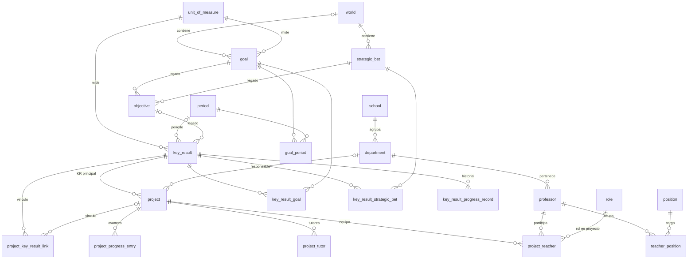

# Esquema de la base de datos

Describe el esquema PostgreSQL del MTE tal como queda despues de aplicar las migraciones Flyway `V1` a `V15` (carpeta [src/main/resources/db/migration](../src/main/resources/db/migration)). La fuente de verdad son esas migraciones; este documento las resume.

- Motor: PostgreSQL 17 (recurso PostgreSQL del servidor Coolify de la universidad).
- Esquema: `public`. Flyway guarda su historial en `flyway_schema_history`.
- En staging y produccion Hibernate arranca con `ddl-auto: validate`: si una entidad JPA no coincide con las tablas, la API no arranca.
- Las llaves primarias son `BIGINT GENERATED BY DEFAULT AS IDENTITY`, salvo en las tablas de union, que usan llave compuesta.
- Las fechas con hora son `TIMESTAMP WITH TIME ZONE`; las fechas sin hora son `DATE`.
- Los estados y tipos se guardan como texto (`VARCHAR`) con el nombre del enum de Java. Los valores validos estan en la seccion [Valores de estados y tipos](#valores-de-estados-y-tipos).
- El MTE no calcula avances: `key_result.progress_percentage`, `key_result.current_value` y `project.global_progress` son valores que registra una persona.
- La API autentica por si misma (V15): las contrasenas se guardan solo como hash BCrypt en `auth_credential`, los enlaces de acceso solo como hash SHA-256 en `auth_link_token` y las sesiones cerradas en `auth_revoked_token`. `professor.auth_user_id` apunta a `auth_credential.user_id`.

## Diagrama entidad-relacion

Solo muestra llaves y relaciones. Las columnas completas estan en las tablas de la seccion siguiente.



## Jerarquia estrategica

```text
Mundo (world)
 |-- Apuesta estrategica (strategic_bet)      1 mundo : N apuestas
 |-- Meta institucional (goal)                1 mundo : N metas (opcional)
Key Result (key_result)                       N:M con metas y N:M con apuestas (desde V10)
 |-- Proyecto (project)                       cada proyecto tiene un KR principal
 |-- Vinculos proyecto-KR (project_key_result_link)
```

Desde `V10` el Objetivo ya no es un nivel de la jerarquia. La tabla `objective` y la columna `key_result.objective_id` se conservan solo para no perder datos historicos; ningun codigo las lee ni las escribe y no tienen entidad JPA.

## Tablas

### Catalogos

#### `school` (escuela)

| Columna | Tipo | Nulo | Notas |
|---|---|---|---|
| id | BIGINT | no | PK |
| name | VARCHAR(255) | no | Unico (`uk_school_name`) |
| description | TEXT | si | |

#### `department` (departamento)

| Columna | Tipo | Nulo | Notas |
|---|---|---|---|
| id | BIGINT | no | PK |
| name | VARCHAR(255) | no | |
| description | TEXT | si | |
| school_id | BIGINT | no | FK `school.id` |
| external_department_id | BIGINT | si | Identificador en el sistema institucional |

#### `period` (periodo academico)

| Columna | Tipo | Nulo | Notas |
|---|---|---|---|
| id | BIGINT | no | PK |
| name | VARCHAR(255) | no | Unico (`uk_period_name`), p. ej. `2026-2` |
| start_date | DATE | no | |
| end_date | DATE | no | |
| status | VARCHAR(255) | si | `PeriodStatus` |

#### `unit_of_measure` (unidad de medida)

| Columna | Tipo | Nulo | Notas |
|---|---|---|---|
| id | BIGINT | no | PK |
| name | VARCHAR(255) | no | Unico (`uk_unit_of_measure_name`) |
| type | VARCHAR(255) | no | `MeasurementUnitType` |
| description | TEXT | si | |
| active | BOOLEAN | no | Por defecto `TRUE` |

#### `position` (cargo institucional)

| Columna | Tipo | Nulo | Notas |
|---|---|---|---|
| id | BIGINT | no | PK |
| name | VARCHAR(255) | no | Unico (`uk_position_name`) |
| description | TEXT | si | |

#### `role` (rol dentro de un proyecto)

Rol de una persona en el equipo de un proyecto (por ejemplo, tutor). No es el rol de acceso a la plataforma, que esta en `professor.access_role`.

| Columna | Tipo | Nulo | Notas |
|---|---|---|---|
| id | BIGINT | no | PK |
| name | VARCHAR(255) | no | Unico (`uk_role_name`) |
| description | TEXT | si | |

### Personas y acceso

#### `professor` (persona del directorio)

Toda persona que usa la plataforma, con su rol de acceso.

| Columna | Tipo | Nulo | Notas |
|---|---|---|---|
| id | BIGINT | no | PK |
| name | VARCHAR(255) | no | |
| email | VARCHAR(255) | no | Unico (`uk_professor_email`) |
| department_id | BIGINT | no | FK `department.id` |
| access_role | VARCHAR(32) | no | `ADMIN`, `MANAGER`, `CONTRIBUTOR` o `VISITOR` (check `ck_professor_access_role`). Por defecto `CONTRIBUTOR` |
| active | BOOLEAN | no | Por defecto `TRUE`. Una persona inactiva no puede entrar |
| last_access_at | TIMESTAMPTZ | si | Ultimo ingreso |
| auth_user_id | UUID | si | Unico (`uk_professor_auth_user_id`). Cuenta de acceso (`auth_credential.user_id`). No es FK: la cuenta se crea al generar el primer enlace |
| failed_login_attempts | INTEGER | no | Por defecto `0`. Intentos fallidos seguidos |
| locked_until | TIMESTAMPTZ | si | Bloqueo temporal tras varios intentos fallidos |

#### `teacher_position` (cargos de cada persona)

| Columna | Tipo | Nulo | Notas |
|---|---|---|---|
| position_id | BIGINT | no | PK compuesta, FK `position.id` |
| teacher_id | BIGINT | no | PK compuesta, FK `professor.id` |
| is_active | BOOLEAN | si | |

#### `auth_credential` (cuenta de acceso, V15)

| Columna | Tipo | Nulo | Notas |
|---|---|---|---|
| user_id | UUID | no | PK. Es el `professor.auth_user_id` de la persona |
| password_hash | VARCHAR(100) | si | Hash BCrypt (costo 12). Nulo mientras la persona no fija su contrasena |
| created_at | TIMESTAMPTZ | no | |
| updated_at | TIMESTAMPTZ | no | |

#### `auth_link_token` (enlaces de acceso de un solo uso, V15)

| Columna | Tipo | Nulo | Notas |
|---|---|---|---|
| id | BIGINT | no | PK |
| token_hash | VARCHAR(64) | no | Unico (`uk_auth_link_token_token_hash`). SHA-256 en hexadecimal; el enlace en claro no se guarda |
| user_id | UUID | no | FK `auth_credential.user_id` con `ON DELETE CASCADE` |
| link_type | VARCHAR(16) | no | `invite` (primera vez) o `recovery` |
| expires_at | TIMESTAMPTZ | no | Por defecto 72 horas despues de crearlo |
| used_at | TIMESTAMPTZ | si | Fecha de uso. Un enlace nuevo marca como usados los anteriores de la misma cuenta |
| created_at | TIMESTAMPTZ | no | |

#### `auth_revoked_token` (sesiones cerradas, V15)

| Columna | Tipo | Nulo | Notas |
|---|---|---|---|
| token_id | VARCHAR(64) | no | PK. `jti` del token de acceso cerrado con logout |
| expires_at | TIMESTAMPTZ | no | Vencimiento del token; pasada esa fecha la fila ya no hace falta |

### Estrategia

#### `world` (mundo)

| Columna | Tipo | Nulo | Notas |
|---|---|---|---|
| id | BIGINT | no | PK |
| name | VARCHAR(255) | no | Unico (`uk_world_name`) |
| description | TEXT | si | |

#### `strategic_bet` (apuesta estrategica)

| Columna | Tipo | Nulo | Notas |
|---|---|---|---|
| id | BIGINT | no | PK |
| name | VARCHAR(255) | no | Unico (`uk_strategic_bet_name`) |
| description | TEXT | no | |
| start_date | DATE | no | |
| end_date | DATE | no | |
| status | VARCHAR(255) | si | `StrategicStatus` |
| created_at | TIMESTAMPTZ | si | |
| world_id | BIGINT | no | FK `world.id` |

#### `goal` (meta institucional)

| Columna | Tipo | Nulo | Notas |
|---|---|---|---|
| id | BIGINT | no | PK |
| name | VARCHAR(255) | no | |
| description | TEXT | no | |
| reference_indicator | VARCHAR(255) | si | |
| expected_value | NUMERIC(12,2) | no | |
| start_date | DATE | no | |
| end_date | DATE | no | |
| status | VARCHAR(255) | si | `StrategicStatus` |
| created_at | TIMESTAMPTZ | si | |
| world_id | BIGINT | si | FK `world.id` |
| unit_of_measure_id | BIGINT | no | FK `unit_of_measure.id` |

#### `goal_period` (periodos de cada meta)

| Columna | Tipo | Nulo | Notas |
|---|---|---|---|
| goal_id | BIGINT | no | PK compuesta, FK `goal.id` |
| period_id | BIGINT | no | PK compuesta, FK `period.id` |

#### `key_result` (resultado clave, KR)

| Columna | Tipo | Nulo | Notas |
|---|---|---|---|
| id | BIGINT | no | PK |
| name | VARCHAR(255) | no | |
| description | VARCHAR(255) | no | |
| metric | VARCHAR(255) | no | |
| base_value | NUMERIC(12,2) | no | |
| target_value | NUMERIC(12,2) | no | |
| current_value | NUMERIC(12,2) | si | Valor registrado a mano |
| progress_percentage | NUMERIC(10,2) | si | Porcentaje registrado a mano |
| status | VARCHAR(255) | no | `KeyResultStatus` (V8) |
| created_at | TIMESTAMPTZ | si | |
| academic_period_id | BIGINT | si | FK `period.id` |
| unit_of_measure_id | BIGINT | no | FK `unit_of_measure.id` |
| objective_id | BIGINT | si | Legado, FK `objective.id`. Opcional desde V10 y sin uso |
| planner_url | VARCHAR(2048) | si | Enlace al plan en Microsoft Planner (V12) |
| archived | BOOLEAN | no | Por defecto `FALSE` (V13). Un KR archivado no cuenta en portada ni cierre |
| archived_at | TIMESTAMPTZ | si | Fecha en que se archivo (V13) |

#### `key_result_goal` y `key_result_strategic_bet` (V10)

Vinculos N:M del KR con metas y con apuestas. Al borrar un KR se borran sus vinculos (`ON DELETE CASCADE`).

| Tabla | Columnas | Llaves |
|---|---|---|
| key_result_goal | key_result_id, goal_id | PK compuesta; FK `key_result.id` (cascade) y `goal.id` |
| key_result_strategic_bet | key_result_id, strategic_bet_id | PK compuesta; FK `key_result.id` (cascade) y `strategic_bet.id` |

#### `key_result_progress_record` (historial de avance del KR, V14)

Una fila por cada registro de avance. Guarda el valor anterior y el nuevo para mostrar el historial.

| Columna | Tipo | Nulo | Notas |
|---|---|---|---|
| id | BIGINT | no | PK |
| key_result_id | BIGINT | no | FK `key_result.id` |
| previous_value | NUMERIC(12,2) | si | |
| current_value | NUMERIC(12,2) | no | |
| previous_percentage | NUMERIC(10,2) | si | |
| progress_percentage | NUMERIC(10,2) | no | |
| author_name | VARCHAR(255) | si | Quien registro el avance |
| author_email | VARCHAR(255) | si | |
| recorded_at | TIMESTAMPTZ | no | |

### Proyectos

#### `project` (proyecto)

| Columna | Tipo | Nulo | Notas |
|---|---|---|---|
| id | BIGINT | no | PK |
| name | VARCHAR(255) | no | |
| description | TEXT | no | |
| type | VARCHAR(255) | si | `ProjectType` |
| status | VARCHAR(255) | si | `ProjectStatus` |
| start_period / end_period | VARCHAR(20) | no | Nombre del periodo, p. ej. `2026-1` |
| start_date / end_date | DATE | si | |
| actual_end_date | DATE | si | |
| jira_key | VARCHAR(255) | si | |
| key_result_id | BIGINT | no | FK `key_result.id`. KR principal del proyecto |
| contribution_weight | NUMERIC(5,2) | si | |
| link_status | VARCHAR(255) | si | |
| department_id | BIGINT | si | FK `department.id` |
| department_name | VARCHAR(255) | si | Copia del nombre para proyectos externos |
| global_progress | NUMERIC(5,2) | no | Por defecto `0`. Avance registrado a mano |
| origin | VARCHAR(255) | no | `ProjectOrigin`, por defecto `LOCAL` |
| sync_status | VARCHAR(255) | no | `ProjectSyncStatus`, por defecto `LOCAL_ONLY` |
| external_project_id | BIGINT | si | Unico junto con `external_source` (`uk_project_external_source_id`) |
| external_source | VARCHAR(255) | si | |
| last_synced_at | TIMESTAMPTZ | si | |
| raw_external_payload | TEXT | si | Respuesta original del sistema externo |
| planner_url | VARCHAR(2048) | si | Enlace a Microsoft Planner (V12) |
| created_at | TIMESTAMPTZ | si | |
| updated_at | TIMESTAMPTZ | no | |

#### `project_key_result_link` (vinculo proyecto-KR)

Vinculo de un proyecto, local o externo, con un KR. Un vinculo desactivado se conserva con `active = FALSE`.

| Columna | Tipo | Nulo | Notas |
|---|---|---|---|
| id | BIGINT | no | PK |
| key_result_id | BIGINT | no | FK `key_result.id` |
| project_id | BIGINT | si | FK `project.id` (vacio si el proyecto solo existe afuera) |
| external_project_id | BIGINT | si | |
| external_project_source | VARCHAR(255) | no | |
| contribution_weight | NUMERIC(5,2) | no | |
| contribution_type | VARCHAR(255) | no | `ContributionType`, por defecto `DIRECTA` |
| active | BOOLEAN | no | Por defecto `TRUE` |
| created_at | TIMESTAMPTZ | no | |

#### `project_progress_entry` (avance de proyecto)

| Columna | Tipo | Nulo | Notas |
|---|---|---|---|
| id | BIGINT | no | PK |
| project_id | BIGINT | no | FK `project.id` |
| progress_percent | NUMERIC(5,2) | no | |
| comment | TEXT | no | |
| milestones | TEXT | si | |
| created_by_external_user_id | BIGINT | si | |
| created_at | TIMESTAMPTZ | no | |

#### `project_teacher` (equipo del proyecto)

| Columna | Tipo | Nulo | Notas |
|---|---|---|---|
| project_id | BIGINT | no | PK compuesta, FK `project.id` |
| teacher_id | BIGINT | no | PK compuesta, FK `professor.id` |
| role_id | BIGINT | no | PK compuesta, FK `role.id` |
| joined_at | DATE | no | |
| left_at | DATE | si | |

#### `project_tutor` (tutores por nombre)

Lista de nombres de tutores de un proyecto (coleccion de la entidad `Project`). No tiene llave primaria.

| Columna | Tipo | Nulo | Notas |
|---|---|---|---|
| project_id | BIGINT | no | FK `project.id` |
| tutor_name | VARCHAR(255) | no | |

### Auditoria

#### `audit_log` (bitacora de cambios)

No tiene llaves foraneas: guarda el tipo y el identificador de la entidad como texto para que el registro sobreviva aunque la entidad cambie.

| Columna | Tipo | Nulo | Notas |
|---|---|---|---|
| id | BIGINT | no | PK |
| action | VARCHAR(255) | no | `AuditAction` |
| entity_type | VARCHAR(255) | no | p. ej. `KEY_RESULT` |
| entity_id | VARCHAR(255) | no | |
| summary | VARCHAR(255) | no | |
| actor_external_user_id | BIGINT | si | |
| actor_username | VARCHAR(255) | si | |
| actor_roles | TEXT | si | |
| before_snapshot | TEXT | si | JSON del estado anterior |
| after_snapshot | TEXT | si | JSON del estado nuevo |
| created_at | TIMESTAMPTZ | no | |

### Legado

#### `objective` (objetivo, sin uso desde V10)

Se conserva para no perder datos. No tiene entidad JPA. Columnas: `id`, `name`, `description`, `status`, `status_before_archive` (V8), `estimated_weight`, `created_at`, `created_by` (FK `professor.id`), `created_by_external_user_id`, `goal_id` (FK `goal.id`), `strategic_bet_id` (FK `strategic_bet.id`), `quarter` (INTEGER entre 1 y 4, check `ck_objective_quarter`), `completion_percentage`, `department_id` (FK `department.id`) y `academic_period_id` (FK `period.id`).

## Valores de estados y tipos

| Columna | Enum de Java | Valores |
|---|---|---|
| `period.status` | `PeriodStatus` | `ACTIVO`, `CERRADO`, `PLANIFICACION` |
| `unit_of_measure.type` | `MeasurementUnitType` | `NUMERICA`, `PORCENTAJE`, `BOOLEANA`, `OTRA` |
| `goal.status`, `strategic_bet.status` | `StrategicStatus` | `ACTIVA`, `INACTIVA` |
| `key_result.status` | `KeyResultStatus` | `BORRADOR`, `ACTIVO`, `CERRADO` |
| `project.status` | `ProjectStatus` | `BORRADOR`, `ACTIVO`, `FINALIZADO`, `SUSPENDIDO`, `ARCHIVADO` |
| `project.type` | `ProjectType` | `GRADO`, `INVESTIGACION`, `EXTENSION`, `MACROPROYECTO` |
| `project.origin` | `ProjectOrigin` | `LOCAL`, `SYNCED` |
| `project.sync_status` | `ProjectSyncStatus` | `LOCAL_ONLY`, `SYNCED`, `SYNC_FAILED` |
| `project_key_result_link.contribution_type` | `ContributionType` | `DIRECTA`, `INDIRECTA`, `SOPORTE` |
| `professor.access_role` | (texto con check) | `ADMIN`, `MANAGER`, `CONTRIBUTOR`, `VISITOR` |
| `audit_log.action` | `AuditAction` | `CREATE`, `DELETE`, `UPDATE`, `STATUS_CHANGE`, `PROGRESS_REGISTERED`, `LINK_CREATED`, `LINK_REMOVED`, `EXTERNAL_SYNC`, `ACCOUNT_LOCKED`, `ACCESS_LINK_CREATED`, `PASSWORD_CHANGED`, `PASSWORD_SET` |

Salvo `professor.access_role`, la base no restringe estos valores con un check: los valida la API al convertir el texto al enum.

## Indices

Ademas de las llaves primarias y los unicos:

| Tabla | Indices |
|---|---|
| department | `school_id` |
| professor | `department_id` |
| strategic_bet | `world_id` |
| goal | `world_id` |
| key_result | `objective_id`, `academic_period_id` |
| key_result_goal | `goal_id` |
| key_result_strategic_bet | `strategic_bet_id` |
| key_result_progress_record | `(key_result_id, recorded_at DESC)` |
| project | `key_result_id`, `status`, `type`, `department_id`, `(start_period, end_period)` (dos indices iguales: `idx_project_periods` de V1 e `idx_project_period_range` de V6) |
| project_key_result_link | `project_id`, `key_result_id`, `(project_id, active)`, `(key_result_id, active)` |
| audit_log | `(entity_type, entity_id)`, `action`, `created_at` |
| objective | `goal_id`, `strategic_bet_id`, `department_id`, `academic_period_id` (dos indices iguales: `idx_objective_period` de V1 e `idx_objective_academic_period` de V6) |

## Historial de migraciones

| Version | Archivo | Cambio |
|---|---|---|
| V1 | `initial_schema` | Crea las 20 tablas iniciales, sus llaves e indices |
| V2 | `complete_msp_story_fields` | Sin cambios (los campos ya estaban en V1) |
| V3 | `rename_future_period_status` | Sin cambios (los estados ya estaban en V1) |
| V4 | `alter_objective_quarter_to_integer` | `objective.quarter` pasa a `INTEGER` |
| V5 | `seed_demo_users` | Datos base: Escuela TDI, 3 departamentos, 4 cargos y 4 personas |
| V6 | `add_read_model_indexes` | Indices para las consultas de lectura |
| V7 | `restore_hugo_arboleda_director` | Corrige el nombre de `Direccion TDI` y restaura al director |
| V8 | `add_strategy_lifecycle` | `key_result.status` (obligatorio) y `objective.status_before_archive` |
| V9 | `add_directory_user_access` | `professor.access_role`, `active` y `last_access_at` |
| V10 | `retire_objective_links` | Crea `key_result_goal` y `key_result_strategic_bet`, copia los vinculos desde `objective` y vuelve opcional `key_result.objective_id` |
| V11 | `add_account_access` | `professor.auth_user_id`, `failed_login_attempts`, `locked_until` y el rol `VISITOR` |
| V11_1 | `add_initial_admin` | Crea el administrador inicial si no existe y falla si queda sin administrador activo |
| V12 | `add_planner_links` | `planner_url` en `key_result` y `project` |
| V13 | `add_key_result_archive` | `key_result.archived` y `archived_at` |
| V14 | `add_key_result_progress_record` | Tabla `key_result_progress_record` |
| V15 | `add_local_credentials` | Tablas `auth_credential`, `auth_link_token` y `auth_revoked_token`; crea una cuenta sin contrasena para cada persona que ya tenia `auth_user_id` |

Para cambiar el esquema se crea una migracion nueva (nunca se edita una ya aplicada), se prueba en una base desechable y se actualiza este documento. El procedimiento de respaldo antes de migrar esta en [backup-restore.md](backup-restore.md).
